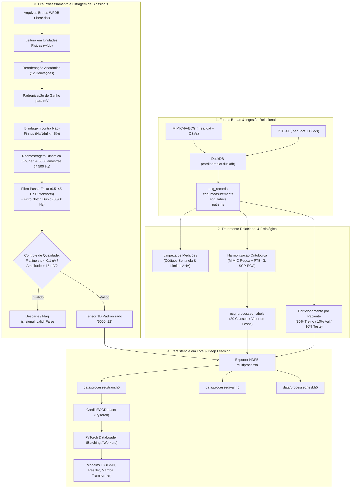

# Pipeline de Processamento e Tratamento de Dados 🫀

Este documento descreve detalhadamente a arquitetura, as regras fisiológicas, os critérios de corte, a esteira de transformação e a persistência do **Pipeline de Processamento e Tratamento de Dados de ECG** do **CardioPredict Server**.

---

## 📌 1. Visão Geral da Arquitetura do Pipeline

O pipeline unifica mais de **820 mil exames de ECG de 12 derivações** provenientes de duas das maiores bases hospitalares mundiais (**MIMIC-IV-ECG** dos EUA e **PTB-XL** da Alemanha). Ele resolve três desafios fundamentais de bioinformática e deep learning:
1. **Heterogeneidade de Dados**: Fusão de laudos de texto livre não estruturados (MIMIC) com vocabulário formal SCP-ECG (PTB-XL).
2. **Qualidade e Calibração Fisiológica**: Padronização física em milivolts (mV), alinhamento temporal em 500 Hz (5.000 amostras), ordenação anatômica das 12 derivações e filtragem digital de ruídos.
3. **Eficiência de I/O e Escala**: Substituição de centenas de milhares de arquivos soltos por contêineres HDF5 particionados com compressão rápida LZF, permitindo acesso aleatório $O(1)$ para treinamento em PyTorch.

### Diagrama de Fluxo Ponta a Ponta



---

## 🗄️ 2. Ingestão e Estrutura dos Dados no DuckDB

Os metadados tabulares e diagnósticos de ambas as bases são consolidados em um banco colunar embutido de altíssimo desempenho: `data/cardiopredict.duckdb`.

* **Módulo responsável**: [`src/data/database.py`](file:///home/yuri-monteiro/Documentos/projetos/cadiopredict20/server/src/data/database.py)
* **Script de migração**: `python src/database.py`

### Principais Tabelas Relacionais:
1. `patients`: Cadastro unificado dos pacientes (`patient_uid`, sexo, idade calculada no exame).
2. `ecg_records`: Catálogo mestre dos 821.834 exames com metadados do hardware (frequência de amostragem original, caminho relativo do arquivo WFDB, partição `split`, indicador `is_signal_valid`). No PTB-XL, vincula-se exclusivamente a versão de alta resolução `records500/` (`filename_hr` a 500 Hz), ignorando a pasta redundante `records100/` para evitar duplicatas artificiais dos mesmos 21.837 exames.
3. `ecg_measurements`: Intervalos clínicos computados pelo algoritmo do eletrocardiógrafo (frequência cardíaca, intervalo PR, duração QRS, intervalo QT, QT corrigido e eixos elétricos frontais).
4. `ecg_labels`: Declarações diagnósticas originais por exame (laudos de texto livre do MIMIC e dicionários de termos SCP do PTB-XL).
5. `ecg_processed_labels`: Matriz multilabel harmonizada (30 colunas de rótulo binário e 30 colunas de pesos de incerteza).

---

## 🩺 3. Limpeza e Tratamento de Medições Clínicas

Os eletrocardiógrafos digitais de hospitais registram medições automáticas de intervalos e eixos, mas frequentemente utilizam **códigos sentinela** para indicar falha de cálculo ou eletrodo desconectado.

* **Módulo responsável**: [`src/processing/measurements.py`](file:///home/yuri-monteiro/Documentos/projetos/cadiopredict20/server/src/processing/measurements.py)
* **Decisão documentada**: [limites_fisiologicos_medicoes.md](limites_fisiologicos_medicoes.md)

### Tratamento de Códigos Sentinela de Hardware:
Valores como `29999`, `32767`, `-32768` e `65535` são códigos de saturação ou falha interna do circuito de medição do fabricante. Esses valores são automaticamente convertidos para `NaN` (`NULL` no DuckDB).

### Limites Fisiológicos Válidos (Diretrizes AHA/ACC):
Qualquer valor fora das seguintes faixas biologicamente plausíveis é tratado como inconsistente e substituído por `NULL`:

| Parâmetro | Unidade | Faixa Plausível Mínima | Faixa Plausível Máxima | Comentário Clínico |
| :--- | :---: | :---: | :---: | :--- |
| **Frequência Cardíaca (HR)** | bpm | 20 | 300 | Abaixo de 20 é assistolia/bradicardia extrema; acima de 300 é flutter ventricular. |
| **Intervalo PR** | ms | 80 | 400 | Condução atrioventricular (tempo entre início da onda P e início do QRS). |
| **Duração QRS** | ms | 40 | 250 | Despolarização ventricular (acima de 120 ms indica bloqueio de ramo). |
| **Intervalo QT** | ms | 200 | 700 | Repolarização ventricular total. |
| **Intervalo QTc (Bazett)** | ms | 250 | 750 | QT corrigido pela frequência cardíaca. |
| **Eixos Frontais (P, QRS, T)** | graus (°) | -180 | 180 | Ângulos no plano frontal do triângulo de Einthoven. |

---

## ⚡ 4. Engenharia e Filtragem de Biossinais (Sinal 1D)

O sinal bruto do eletrocardiograma é sujeito a diversos ruídos: respiração do paciente (oscilação de baixa frequência na linha de base), tremor muscular (eletromiograma de alta frequência), ruído da rede elétrica (50 Hz na Europa, 60 Hz nas Américas) e desconexão parcial de eletrodos.

* **Módulo responsável**: [`src/processing/signal.py`](file:///home/yuri-monteiro/Documentos/projetos/cadiopredict20/server/src/processing/signal.py)
* **Decisão documentada**: [decisoes_processamento_sinal.md](decisoes_processamento_sinal.md) e [limitadores_qualidade_sinal.md](limitadores_qualidade_sinal.md)

### Etapas da Cadeia de Processamento de Sinal:

```
[Sinal WFDB Bruto]
       │
       ▼
1. Reordenação das 12 Derivações ──> Ordem universal: I, II, III, aVR, aVL, aVF, V1..V6
       │
       ▼
2. Calibração de Amplitude       ──> Conversão de uV / LSB para milivolts (mV)
       │
       ▼
3. Tratamento de Amostras NaN    ──> Interpolação linear se <= 5% (250 amostras)
       │
       ▼
4. Filtragem Passa-Faixa         ──> Butterworth 4ª ordem (0.5 Hz a 45 Hz) bidirecional
       │
       ▼
5. Filtro Notch Duplo            ──> Rejeita 50 Hz (Europa) e 60 Hz (EUA) com fator Q=30
       │
       ▼
6. Checagem de Qualidade Fisiológica:
   ├─ Desvio Padrão < 0.1 uV?     ──> Rejeita exame (eletrodo mudo / flatline)
   └─ Amplitude > 15 mV?          ──> Rejeita exame (saturação mecânica/artefato)
       │
       ▼
[Tensor 1D Final: shape (5000, 12) em float32]
```

1. **Ordem Estrita das 12 Derivações (`STANDARD_LEADS`)**:
   `['I', 'II', 'III', 'aVR', 'aVL', 'aVF', 'V1', 'V2', 'V3', 'V4', 'V5', 'V6']`. O alinhamento espacial preserva as correlações anatômicas do miocárdio (paredes inferior, anterior, lateral e septal).
2. **Normalização de Amplitude**:
   Garante que todas as derivações estejam exatamente na escala física de **milivolts (mV)**, tratando discrepâncias entre sensores e bancos (ex.: sinais reportados em $\mu\text{V}$ multiplicados por $10^{-3}$).
3. **Interpolação de NaNs**:
   Se a derivação apresentar até $5\%$ de valores ausentes (máximo de 250 amostras em 5.000), esses trechos são suavemente reconstruídos por interpolação linear (`np.interp`). Se exceder $5\%$, o exame é descartado.
4. **Filtro Passa-Faixa Butterworth (0.5 Hz a 45 Hz)**:
   * **Corte inferior (0.5 Hz)**: Remove a oscilação da linha de base gerada pelos movimentos respiratórios do paciente.
   * **Corte superior (45 Hz)**: Atenua interferências musculares (EMG) e ruídos de alta frequência, mantendo intactos o complexo QRS e as ondas P e T.
   * **Implementação bidirecional de fase zero (`sosfiltfilt`)**: Garante que os picos das ondas R e intervalos clínicos não sofram deslocamentos de fase temporais.
5. **Filtro Notch Duplo (50 Hz / 60 Hz)**:
   Filtro rejeita-faixa IIR de alto fator de qualidade ($Q=30$) aplicado em 50 Hz e 60 Hz para eliminar a indução eletromagnética da rede elétrica sem alterar a morfologia diagnóstica.
6. **Critérios de Rejeição de Sinal Ruim**:
   * **Eletrodo Mudo (*Flatline*)**: Derivação com desvio padrão inferior a $10^{-4}\text{ mV}$ ($0,1\ \mu\text{V}$).
   * **Picos Aberrantes**: Amplitudes absolutas superiores a $15\text{ mV}$ após filtragem.

---

## 🏷️ 5. Harmonização Ontológica Multilabel

Na prática clínica cardiológica, um único eletrocardiograma quase nunca apresenta uma única patologia isolada. Um paciente com infarto agudo pode apresentar concomitantemente fibrilação atrial e bloqueio de ramo esquerdo. Por essa razão, a modelagem é estritamente **Multilabel** (saídas com ativação `Sigmoid` e função de custo `BCEWithLogitsLoss`).

* **Módulo responsável**: [`src/processing/ontology.py`](file:///home/yuri-monteiro/Documentos/projetos/cadiopredict20/server/src/processing/ontology.py)
* **Geração relacional**: [`src/data/labels.py`](file:///home/yuri-monteiro/Documentos/projetos/cadiopredict20/server/src/data/labels.py)
* **Decisão documentada**: [decisoes_taxonomia_multilabel.md](decisoes_taxonomia_multilabel.md)

### As 30 Classes Alvo Padronizadas (`TARGET_CLASSES`):

#### 5 Superclasses Clínicas (Ontologia SCP-ECG):
1. `NORM`: Eletrocardiograma dentro dos limites normais.
2. `MI`: Infarto do Miocárdio (agudo, prévio ou indeterminado).
3. `STTC`: Alterações de Repolarização Ventricular / Isquemia (Segmento ST e Onda T).
4. `CD`: Distúrbios de Condução Cardíaca e Bloqueios.
5. `HYP`: Sobrecarga / Hipertrofia Ventricular ou Atrial.

#### 25 Subclasses Específicas de Emergência:
* **Arritmias e Ritmos**: `AFIB` (Fibrilação Atrial), `AFLT` (Flutter Atrial), `SR` (Ritmo Sinusal), `SBRAD` (Bradicardia Sinusal), `STACH` (Taquicardia Sinusal), `PVC` (Extrassístole Ventricular), `PAC` (Extrassístole Atrial).
* **Infartos e Isquemias**: `AMI` (Infarto Anterior/Anterosseptal), `IMI` (Infarto Inferior), `LMI` (Infarto Lateral), `STEMI` (Infarto com Supradesnivelamento de ST), `STTC_ISCA` (Isquemia Anterior), `STTC_ISCI` (Isquemia Inferior), `STD` (Infradesnivelamento de ST), `STE` (Supradesnivelamento de ST inespecífico).
* **Bloqueios e Condução**: `CLBBB` (Bloqueio Completo de Ramo Esquerdo), `CRBBB` (Bloqueio Completo de Ramo Direito), `IRBBB` (Bloqueio Incompleto de Ramo Direito), `LAFB` (Bloqueio Divisional Anterossuperior Esquerdo), `1AVB` (BAV 1º Grau), `2AVB` (BAV 2º Grau), `3AVB` (BAV Total/3º Grau), `IVCD` (Atraso Inespecífico de Condução Intraventricular).
* **Hipertrofias**: `LVH` (Sobrecarga Ventricular Esquerda), `RVH` (Sobrecarga Ventricular Direita).

### Regras de Ponderação e Propagação Hierárquica:
1. **Confiança e Incerteza Clínica (`weights`)**:
   * Termos diagnósticos definitivos recebem peso $1,0$.
   * Termos com incerteza no laudo médico (ex.: *"possível infarto"*, *"não se pode descartar isquemia"*, *"sugere sobrecarga"*) recebem peso $0,5$, permitindo aprendizado atenuado pela função de custo ponderada.
2. **Propagação Hierárquica Automática**:
   * Se qualquer classe de infarto for positiva (`AMI`, `IMI`, `LMI`, `STEMI`), a superclasse `MI` é automaticamente ativada como $1$.
   * Se qualquer bloqueio de condução for positivo (`CLBBB`, `CRBBB`, etc.), a superclasse `CD` é ativada.
   * Se houver hipertrofia (`LVH`, `RVH`), a superclasse `HYP` é ativada.
3. **Exclusão Mútua de Normalidade**:
   * Se qualquer patologia for confirmada ativa, o rótulo `NORM` é forçado para $0$.
4. **Exames Sem Diagnóstico Alvo (`is_supervised_target = False`)**:
   * Exames com laudos inespecíficos ou puramente técnicos que não mencionam nem normalidade nem patologias alvo são preservados no banco com `is_supervised_target = False`, evitando ruído no treino supervisionado.

---

## 👥 6. Particionamento e Prevenção de Vazamento de Dados

A regra mais crítica de integridade científica em aprendizado profundo médico é a **prevenção de Data Leakage**.

* **Módulo responsável**: [`src/data/split.py`](file:///home/yuri-monteiro/Documentos/projetos/cadiopredict20/server/src/data/split.py)
* **Decisão documentada**: [decisoes_selecao_particionamento.md](decisoes_selecao_particionamento.md)

### Por que o Particionamento é no Nível do Paciente?
No ambiente hospitalar, um mesmo paciente frequentemente realiza múltiplos exames de ECG durante a internação (às vezes 5 a 10 exames em dias consecutivos). A anatomia da caixa torácica, a posição do coração e as particularidades individuais de impedância elétrica geram padrões biométricos únicos.
Se os exames fossem particionados aleatoriamente, exames do mesmo paciente estariam presentes no Treino e no Teste simultaneamente, criando uma ilusão de alta acurácia (o modelo reconhece o "formato do tórax do paciente", e não a patologia cardíaca).

### Divisão Estabelecida:
* **Treino (`train`)**: 80% dos pacientes (657.689 exames — 97,35% MIMIC / 2,65% PTB-XL)
* **Validação (`val`)**: 10% dos pacientes (81.697 exames — 97,33% MIMIC / 2,67% PTB-XL)
* **Teste (`test`)**: 10% dos pacientes (82.448 exames — 97,33% MIMIC / 2,67% PTB-XL)
* **Garantia matemática**: $\text{Pacientes}(\text{Treino}) \cap \text{Pacientes}(\text{Validação}) \cap \text{Pacientes}(\text{Teste}) = \emptyset$.
* **Benchmark Duplo**: O teste é avaliado no conjunto Global Transcontinental (82.448 exames) e também isoladamente na Dobra 10 do PTB-XL (2.198 exames) para comparação direta com os artigos do estado da arte internacional (PhysioNet Challenge).

---

## 💾 7. Persistência Física em Lote e Otimização de I/O (HDF5)

O treinamento de redes neurais profundas em biossinais exige uma taxa de transferência de dados contínua e massiva.

* **Módulo responsável**: [`src/data/exporter_h5.py`](file:///home/yuri-monteiro/Documentos/projetos/cadiopredict20/server/src/data/exporter_h5.py)
* **Decisão documentada**: [decisoes_armazenamento_hdf5_arquivos.md](decisoes_armazenamento_hdf5_arquivos.md) e [wfdb_vs_hdf5_papeis.md](wfdb_vs_hdf5_papeis.md)

### Por que não utilizar arquivos `.npy` individuais?
Salvar 820.000 arquivos individuais soltos causaria esgotamento da tabela de metadados (*inodes*) do sistema de arquivos Linux, fragmentação em disco e degradação drástica na velocidade de leitura durante o *shuffle* de lotes.

### Arquitetura dos Contêineres HDF5:
O exporter multiprocesso gera três arquivos compactados em `data/processed/`:
1. `train.h5`
2. `val.h5`
3. `test.h5`

Dentro de cada contêiner HDF5, os seguintes *datasets* residem de forma sincronizada pelo mesmo índice inteiro:
* `signals`: Tensor de dimensões $(N, 5000, 12)$ do tipo `float32`, armazenado em *chunks* de $(128, 5000, 12)$ com algoritmo de compressão rápida `lzf`.
* `labels`: Matriz binária $(N, 30)$ do tipo `float32`.
* `weights`: Matriz de confiança clínica $(N, 30)$ do tipo `float32`.
* `ecg_uids`: Vetor de identificadores únicos $(N)$ em strings ASCII codificadas.

---

## 🧠 8. Integração com Deep Learning e PyTorch DataLoader

Para conectar os contêineres HDF5 às arquiteturas de aprendizado profundo (ResNet-1D, CNNs, Transformers e Mamba), o projeto implementa uma classe `Dataset` nativa do PyTorch com suporte seguro a leitura concorrente em múltiplos *workers*.

* **Módulo responsável**: [`src/data/dataset.py`](file:///home/yuri-monteiro/Documentos/projetos/cadiopredict20/server/src/data/dataset.py)

### Características do `CardioECGDataset`:
* **Abertura Sob Demanda (*Lazy Initialization*)**: Evita travamentos de *fork* e conflitos de *file descriptor* quando o PyTorch utiliza múltiplos processos de leitura (`num_workers > 0`).
* **Complexidade $O(1)$ de Acesso**: Leitura direta por índice na fatia do HDF5 sem necessidade de desserializar arquivos intermediários.
* **Formato de Entrada Adaptado (Channels-First)**: Retorna o tensor de sinal transposto para `(12, 5000)` (onde 12 são os canais anatômicos e 5000 as etapas temporais), formato canônico consumido pelas camadas convolucionais 1D e SSMs.
* **Normalização Z-Score Opcional (`standardize=True`)**: Permite normalização por derivação `(x - mean) / (std + 1e-6)` ou global para estabilização de gradientes em camadas densas e mecanismos de atenção.
* **Balanceamento Automático (`dataset.pos_weights`)**: Fornece o vetor de pesos positivos pré-calculado no contêiner HDF5 para parametrização direta de `torch.nn.BCEWithLogitsLoss(pos_weight=...)`.
* **Retorno Padrão por Amostra**:
  * `signal_tensor`: `torch.Tensor` float32 de formato `(12, 5000)`.
  * `label_tensor`: `torch.Tensor` float32 de formato `(30,)`.
  * `weight_tensor`: `torch.Tensor` float32 de formato `(30,)` (pesos de confiança e incerteza clínica).

---

## 🛠️ 9. Guia de Execução dos Comandos e Scripts CLI

Abaixo está o roteiro operacional para executar e reproduzir cada etapa do pipeline:

### 1. Migração dos Metadados para DuckDB
Consolida os arquivos CSV das bases MIMIC-IV-ECG e PTB-XL na base DuckDB:
```bash
uv run python src/database.py
```

### 2. Execução da Auditoria de Integridade e Limites Fisiológicos
Verifica estatísticas, integridade de chaves estrangeiras e intervalos médicos:
```bash
uv run python src/data/audit.py
```

### 3. Geração da Matriz Ontológica Multilabel
Executa o motor ontológico e popula a tabela `ecg_processed_labels` no DuckDB:
```bash
uv run python src/data/labels.py
```

### 4. Exportação Multiprocesso dos Sinais para HDF5
Aplica a filtragem digital em lote e grava os arquivos `train.h5`, `val.h5` e `test.h5`:
```bash
# Exportar uma amostra de teste (ex.: 500 exames por partição)
uv run python src/data/exporter_h5.py --limit-per-split 500

# Exportar a totalidade dos exames válidos com todos os núcleos da CPU
uv run python src/data/exporter_h5.py --workers 8 --chunk-size 128
```

### 5. Execução dos Testes Automatizados
Valida todo o pipeline com a suíte de testes unitários e de integração:
```bash
uv run pytest tests/
```

### 6. Protocolo Obrigatório de Validação e Qualidade de Código
Antes de submeter alterações de código:
```bash
uv run ruff check .
uv run ruff format --check .
uv run pyright
```

---

## 🔗 10. Referências e Leitura Complementar

Para aprofundamento nos fundamentos biomédicos e decisões de engenharia, consulte as notas temáticas complementares deste vault:
* [Limitadores de Integridade Física do Sinal](limitadores_qualidade_sinal.md)
* [Limitadores Fisiológicos e Códigos de Hardware](limites_fisiologicos_medicoes.md)
* [Decisões de Seleção e Particionamento por Paciente](decisoes_selecao_particionamento.md)
* [Decisões de Armazenamento Físico: HDF5 vs. 800 Mil Arquivos](decisoes_armazenamento_hdf5_arquivos.md)
* [Papel do WFDB vs HDF5 no Pipeline](wfdb_vs_hdf5_papeis.md)
* [Decisões de Processamento e Filtragem Digital de Biossinais](decisoes_processamento_sinal.md)
* [Decisões de Modelagem Multilabel e Taxonomia Clínica](decisoes_taxonomia_multilabel.md)
* [Anatomia Clínica das 12 Derivações](anatomia_12_derivacoes_clinica.md)
* [Decisões sobre Exames Sem Rótulo](decisoes_exames_sem_rotulo.md)
* [Decisões de Métricas Clínicas em Multilabel](decisoes_metricas_clinicas.md)
